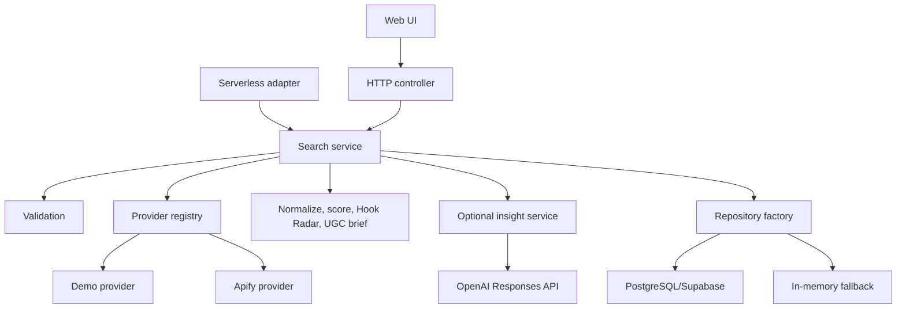

# Architecture

Winning Product Finder separates deterministic product research from optional model-assisted interpretation. The goal is a testable, explainable core with replaceable data sources, storage, and transport layers.

## Design principles

1. **One-way dependencies:** `server -> services -> providers/domain/repositories`.
2. **Transport-independent business logic:** local HTTP and serverless adapters call the same service layer.
3. **Strategy-based providers:** new sources are added through the provider registry.
4. **Graceful degradation:** the application works in demo mode without a database or API key.
5. **Central configuration:** environment variables are read only by `src/config`.
6. **Deterministic first:** rules handle scoring and hook detection; OpenAI is used only for optional semantic analysis.

## Layers

| Layer | Location | Responsibility |
|---|---|---|
| Configuration | `src/config` | Environment loading, validated settings, scoring weights |
| Domain | `src/domain` | Product normalization, scoring, Hook Radar, UGC briefs |
| Providers | `src/providers` | Demo, Apify, and OpenAI adapters |
| Services | `src/services` | Search orchestration and optional insight enrichment |
| Repositories | `src/repositories` | PostgreSQL and in-memory persistence |
| Validation | `src/validation` | Request validation and sanitization |
| Transport | `src/server`, `api/` | Local HTTP and serverless adapters |



## Search pipeline

```text
Validate -> Collect -> Normalize -> Score -> Sort -> Build Hook Radar
         -> Build UGC briefs -> Optional OpenAI insights -> Persist -> Return
```

Every step has one responsibility. Provider output is normalized before domain logic runs, so downstream code does not depend on an external source schema.

## Scoring

The default score is a 100-point weighted model:

- Ad longevity: 45 points
- Ad scale: 30 points
- Product rating: 15 points
- Freshness: 10 points

Weights and normalization caps are configurable through environment variables. The scoring function is deterministic and covered by unit tests.

## Hook Radar and UGC briefs

`src/domain/hooks.js` detects repeatable ad-copy patterns such as questions, pain points, transformations, numbers, convenience, audience call-outs, social proof, and urgency. Patterns are ranked by the average product score of the ads using them rather than raw frequency.

The highest-ranked products receive deterministic 15-second UGC briefs with hook options and a four-shot plan. This output can be passed to AdForge for creative production.

## Optional OpenAI insight layer

When `OPENAI_API_KEY` is configured and a search requests analysis, `insightService` sends only the highest-ranked products to the OpenAI Responses API. Function calling returns structured niche, hook, angle, audience, pain-point, and confidence fields.

This stage is best-effort and cost-limited. Failures do not break the deterministic search pipeline.

## Persistence

The repository factory selects PostgreSQL when `DATABASE_URL` is configured and otherwise uses an in-memory repository. Supabase works through its PostgreSQL connection string; no separate client is required.

Database schema: [`db/schema.sql`](./db/schema.sql).

## Security

- Secrets and local environment files are excluded by `.gitignore`.
- Apify and OpenAI credentials remain server-side.
- Input validation and request-size limits run before provider calls.
- Static-file serving includes path-traversal protection.
- Database credentials are never embedded in source code.
